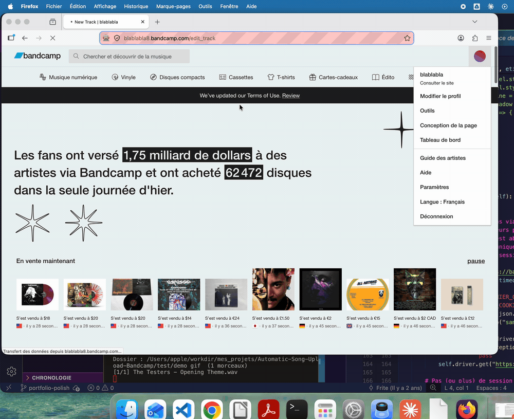
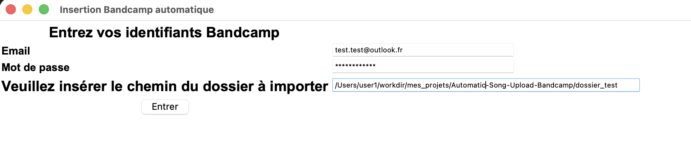

# Automatic Bandcamp Upload

Outil d'automatisation qui publie en masse des morceaux sur [Bandcamp](https://bandcamp.com)
à partir d'un dossier local. Pensé pour un **label ou un artiste à gros catalogue** qui doit
mettre en ligne **sa propre musique** (rééditions, archives, catalogue volumineux) sans répéter
des dizaines de fois le même formulaire web à la main.

> Étude de cas d'automatisation web (Selenium). Le dépôt est cadré pour un usage légitime :
> mettre en ligne de la musique dont on détient les droits.

<p align="center">
  
  <br>
  <em>Chaque champ est surligné au moment où il se remplit (mode démo) — on suit l'upload à l'œil.</em>
</p>

---

## Ce que fait l'outil

À partir d'un dossier contenant des paires audio + pochette  `Artiste - Titre.wav` + `Artiste - Titre.jpg` :

1. liste et apparie les fichiers audio et les pochettes par nom ;
2. ouvre Bandcamp dans Firefox piloté par Selenium ;
3. pour chaque morceau : crée la piste, charge l'audio, renseigne **titre / artiste / tags / prix**,
   charge la pochette, puis publie ;
4. enchaîne tout le dossier, avec **journal d'avancement et barre de progression dans l'interface**.

L'interface propose des **valeurs par défaut** pour le prix et les tags, un **bouton Parcourir**
pour choisir le dossier, et un **mode démo** qui ralentit et surligne chaque champ rempli pour
rendre l'automatisation lisible (utile pour une démonstration ou une vidéo).

<p align="center">
  
</p>

---

## Démarrage rapide

```bash
# 0. Pré-requis : Python 3 et Firefox installés
pip install selenium pillow

# 1. Connexion unique (ouvre Firefox, on se connecte à la main une fois)
python3 login_once.py

# 2. Lancer l'application
python3 mon_tkinter.py
```

Dans la fenêtre : choisir le **dossier**, ajuster **prix** et **tags** si besoin, puis **Lancer l'upload**.
Le bouton **« Se connecter (1re fois) »** déclenche l'étape 1 directement depuis l'interface.

> Un dossier d'exemple (`test/dossier_test/`, pochettes 1400×1400) est fourni et chargé par défaut
> pour tester le flux de bout en bout. `test/demo gif/` contient un seul morceau, pratique pour
> enregistrer une démo courte.

### Convention de nommage des fichiers

- audio : `Artiste - Titre.wav`
- pochette : `Artiste - Titre.jpg` (même nom de base)
- la pochette doit faire **au moins 700×700 px** (contrainte Bandcamp).

---

## Architecture

| Fichier           | Rôle                                                                |
| ----------------- | ------------------------------------------------------------------- |
| `mon_tkinter.py`  | Interface (Tkinter) + orchestration : file d'attente, threads, journal |
| `mon_selenium.py` | Pilotage de Bandcamp (`Pilotage`) : session, navigation, formulaire |
| `mon_os.py`       | Lecture du dossier : appariement `.wav` / `.jpg`, contrôles         |
| `login_once.py`   | Connexion manuelle unique → sauvegarde de la session (cookies)      |

Trois couches séparées (système / automatisation / UI), réutilisables indépendamment.
Le pilotage s'utilise aussi seul : `python3 mon_selenium.py`.

---

## Les vrais défis techniques (le cœur du projet)

Automatiser un site moderne et protégé pose plusieurs problèmes intéressants, résolus ici :

- **CAPTCHA anti-bot** — Bandcamp détecte les navigateurs pilotés et sert un reCAPTCHA.
  On ne le contourne pas (ce serait fragile et malhonnête) : approche **human-in-the-loop**.
  L'utilisateur se connecte **une seule fois** à la main (`login_once.py`), la session est
  sauvegardée en cookies, puis **réutilisée** automatiquement aux lancements suivants.
- **Shadow DOM** — la bannière de cookies est rendue dans le Shadow DOM de `<menu-bar>`,
  invisible aux sélecteurs CSS classiques. On la traverse et on l'accepte via JavaScript.
- **Persistance de session** — sauvegarde / rechargement des cookies d'authentification
  pour éviter de se reconnecter (et de repasser le CAPTCHA) à chaque exécution.
- **Découverte dynamique du DOM** — le sous-domaine de l'artiste et l'URL d'ajout de piste
  sont découverts à l'exécution (le site ayant évolué, les anciens menus ont disparu).
- **Robustesse & UI réactive** — clic tolérant aux overlays (repli JavaScript), traitement en
  thread séparé pour ne pas figer la fenêtre, journal et progression remontés en direct via une file.

---

## Pourquoi pas de VPS ?

Question légitime — et la réponse fait partie de la conception. Cet outil **n'est volontairement
pas un service hébergé** :

- il a besoin d'un **vrai navigateur graphique** (Firefox) et d'une **interaction humaine** (résoudre
  le CAPTCHA une fois). Un VPS *headless* relancerait justement le CAPTCHA qu'on cherche à éviter ;
- il manipule une **session d'authentification personnelle** : la garder en local (cookies gitignorés)
  est plus sûr que sur une machine distante ;
- c'est un **outil de bureau ponctuel** (« j'ai 40 morceaux à publier ce soir »), pas un service 24/7.

C'est donc un **outil local** assumé. La bonne façon de le présenter dans un portfolio n'est pas
un lien vers un VPS, mais une **démo GIF** dans ce README (voir ci-dessous) + le code commenté.

### Enregistrer le GIF de démo

Active le **mode démo** dans l'app (ralenti + surbrillance), lance un upload, capture l'écran,
puis convertis en GIF léger (macOS, avec `ffmpeg`) :

```bash
# enregistrer l'écran -> .mov (QuickTime : Cmd+Shift+5), puis :
ffmpeg -i capture.mov -vf "fps=12,scale=720:-1:flags=lanczos" -loop 0 docs/demo.gif
```

Place le fichier en `docs/demo.gif` : il s'affichera automatiquement en haut de ce README.

---

## Stack

Python · Selenium · Tkinter · Pillow
